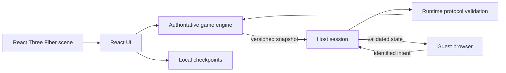

<div align="center">
  

  # Bolsonópolis

  **A browser-based 3D property game about assets, influence, and family business.**

  [](https://github.com/PlazaCC/bolsonopolis/actions/workflows/ci.yml)
  [](https://github.com/PlazaCC/bolsonopolis/deployments/Production)
  [](https://nodejs.org/)
  [](https://www.typescriptlang.org/)

  [](https://react.dev/)
  [](https://threejs.org/)
  [](https://vite.dev/)
  [](https://peerjs.com/)
</div>

Bolsonópolis combines a deterministic property-game engine, a stylized Three.js board, local bot play, and host-authoritative peer-to-peer multiplayer. The player-facing experience is written in Brazilian Portuguese; source code and technical documentation are written in English.

> [!IMPORTANT]
> Bolsonópolis is an independent, unaffiliated work of **political satire and fiction**. Factual references and fictional game effects are presented separately. Factual cards link to primary official records in the in-game source archive.

> [!NOTE]
> The repository is ready for its first deployment candidate, but production promotion requires explicit approval. Until Vercel posts a deployment to GitHub's `Production` environment, the production badge may report an inactive or unknown state.

## Contents

- [Highlights](#highlights)
- [Gameplay model](#gameplay-model)
- [Quick start](#quick-start)
- [Development commands](#development-commands)
- [Architecture](#architecture)
- [Multiplayer, trust, and recovery](#multiplayer-trust-and-recovery)
- [Configuration](#configuration)
- [Quality gates and deployment](#quality-gates-and-deployment)
- [Editorial source policy](#editorial-source-policy)
- [Project structure](#project-structure)
- [Known constraints](#known-constraints)
- [Contributing](#contributing)

## Highlights

| Area | What is implemented |
| --- | --- |
| Board | 40 spaces, four classic corners, 24 property deeds, and six districts |
| Property market | Purchases, auctions, balanced construction, trades, mortgages, debt resolution, and bankruptcy |
| Improvements | Property levels `0–4` with architecture that varies by district, price, and development level |
| Victory | Elimination or a configurable round limit resolved by net worth |
| 3D presentation | Orthographic isometric view from the left, turn-based focus, ledger focus, local recentering, and free inspection controls |
| Multiplayer | Host-authoritative rooms over PeerJS/WebRTC with runtime validation, checkpoints, authenticated reconnection, and pause/resume |
| Editorial model | Critical satire backed by classified primary sources from official institutions |
| Persistence | Local checkpoints and non-destructive migration from the legacy storage namespace |

## Gameplay model

Players move around the board, acquire deeds, complete districts, develop properties, negotiate trades, mortgage assets, and respond to sourced event cards. Financial rules are reduced through a deterministic state machine rather than being calculated in the UI.

Net worth is calculated as:

```text
cash + property value + 50% of improvement cost
```

Net worth determines ranking and round-limit victory, but it is not spendable cash.

The engine uses explicit phases:

```text
lobby → rolling → property/event → auction/trade/debt → manage
                                                   ↘ paused / finished
```

## Quick start

### Prerequisites

- Node.js `22.14.0` through [`.nvmrc`](.nvmrc) is recommended.
- The supported engine range is Node.js `^20.19.0`, `^22.13.0`, or `>=24`.
- npm `11.17.0` is recorded as the project package manager.
- A modern browser with WebGL and WebRTC support is required for the full experience.

### Install and run

```bash
nvm use
npm ci
npm run hooks:install
npm run dev
```

Open the local URL printed by Vite.

For P2P testing, use separate browsers or isolated browser profiles. Two tabs that share browser storage also share the player identity and are not a valid multiplayer test.

## Development commands

| Command | Purpose |
| --- | --- |
| `npm run dev` | Start the Vite development server |
| `npm run lint` | Run ESLint with zero warnings allowed |
| `npm run typecheck` | Run the strict TypeScript project build |
| `npm run test:unit` | Run the Vitest suite once |
| `npm run test:watch` | Run Vitest in watch mode |
| `npm run build` | Create the production bundle in `dist/` |
| `npm run preview` | Serve the production bundle locally |
| `npm run check:push` | Run the lightweight pre-push checks |
| `npm run ci` | Run lint, types, unit tests, and the production build |

## Architecture



The game engine has no React dependency. In multiplayer, guests submit identified intents; the host validates identity and payload bounds, generates random outcomes, reduces the authoritative state, records processed action IDs, increments the state version, saves a checkpoint, and broadcasts a validated snapshot. Camera and animation state remain local to each browser.

Core boundaries:

- [`src/game/engine.ts`](src/game/engine.ts) — authoritative state machine and financial rules.
- [`src/game/content.ts`](src/game/content.ts) — board, characters, satire, and official source archive.
- [`src/network/protocol.ts`](src/network/protocol.ts) — bounded runtime validation for envelopes, intents, snapshots, and identity.
- [`src/network/peer-session.ts`](src/network/peer-session.ts) — PeerJS signalling, WebRTC lifecycle, reconnection, and presence.
- [`src/components/Board3D.tsx`](src/components/Board3D.tsx) — board scene, buildings, camera, animation, and scenery.
- [`src/components/cityLayout.ts`](src/components/cityLayout.ts) — deterministic spatial contracts and reserved zones.
- [`src/App.tsx`](src/App.tsx) — screens and integration between UI, reducer, storage, and network.
- [`src/storage.ts`](src/storage.ts) — current storage namespace and non-destructive legacy migration.

## Multiplayer, trust, and recovery

- The room creator is authoritative. A technically malicious host can modify its own browser; serverless P2P cannot provide cryptographic arbitration.
- The host tab must remain open. There is no automatic host migration.
- If the active guest disconnects, authoritative play pauses until that session reconnects.
- Reconnecting guests must present the private session token associated with their connection metadata.
- Protocol validation rejects malformed envelopes, invalid identities, non-finite or negative financial values, duplicate deeds, stale state, and forbidden internal actions.
- The authoritative checkpoint exists only in the host browser. Clearing site data removes it.
- PeerJS Cloud provides signalling and has no application-specific service-level agreement.
- WebRTC can fail behind strict NAT, corporate firewalls, blocked UDP, or restrictive browser policies; an optional TURN relay can improve reachability.
- The `bolsonopolis-` room prefix is intentionally incompatible with rooms created by older builds.

Checkpoints and preferences migrate on first read from `bolsonapolis:*` to `bolsonopolis:*`. Legacy values are preserved rather than deleted.

## Configuration

Copy [`.env.example`](.env.example) to `.env.local` only when a TURN relay is needed:

```env
VITE_TURN_URL=turns:turn.example.com:5349
VITE_TURN_USERNAME=replace-with-ephemeral-user
VITE_TURN_CREDENTIAL=replace-with-ephemeral-credential
```

All `VITE_*` values are public in the browser bundle. Use short-lived, restricted TURN credentials and never place permanent secrets in these variables.

## Quality gates and deployment

The versioned [`.githooks/pre-push`](.githooks/pre-push) hook runs `npm run check:push`, which includes strict type checking and unit tests. It deliberately excludes browser tests, full builds, network calls, and external services so pushes remain fast. Install it once per clone with:

```bash
npm run hooks:install
```

[GitHub Actions](.github/workflows/ci.yml) is the reproducible source of truth and runs on pushes to `main` and pull requests targeting `main`. The workflow uses locked dependency installation and read-only repository permissions, then executes:

```text
lint → typecheck → unit tests → production build
```

Vercel uses native Git integration with `main` as the production branch and temporary branches as preview environments. [`vercel.json`](vercel.json) enforces `npm ci`, runs the same `npm run ci` verification pipeline, serves `dist/`, applies immutable asset caching, and adds baseline security headers. A candidate that fails the Vercel build is not published even if its GitHub workflow runs independently.

See [the deployment runbook](docs/DEPLOYMENT.md) for integration, preview, promotion, rollback, and environment guidance.

## Editorial source policy

- Satire targets public conduct, contradictions, controversies, and documented statements—not victims.
- Every factual card separates the sourced fact from its fictional mechanical consequence.
- Sources must be primary official records and preserve whether the material is a decision, report, investigation, allegation, recommendation, or clarification.
- A report or recommended indictment must never be presented as a judicial conviction.
- Institutional authorship, limited context, access date, and a stable official URL must be preserved.
- Promotional biography, electoral praise, unsourced generic insults, and disrespect toward victims are out of scope.

The unit suite verifies that factual cards remain connected to classified primary sources from approved official domains.

## Project structure

```text
.
├── .github/workflows/ci.yml   # mandatory remote verification
├── .githooks/pre-push         # fast local push guard
├── docs/
│   ├── assets/                # documentation media
│   ├── COLLABORATION.md       # trunk-based collaboration model
│   └── DEPLOYMENT.md          # Vercel deployment runbook
├── public/                    # static application assets
├── src/
│   ├── components/            # 3D scene and visual components
│   ├── game/                  # rules, content, and unit tests
│   ├── network/               # protocol validation and P2P transport
│   ├── App.tsx                # application integration
│   ├── storage.ts             # persistence and migration
│   └── types.ts               # shared domain types
├── CONTRIBUTING.md
├── vercel.json
└── vite.config.ts
```

## Known constraints

- The shared Three.js production chunk is large and may produce a non-blocking Vite chunk-size warning.
- Initial generation of 3D character portraits can trigger browser or driver `ReadPixels` performance warnings.
- P2P availability depends on both peers' networks and on external signalling or relay infrastructure.
- Browser checkpoints are local recovery aids, not cloud saves.
- Production has not been promoted from this repository without explicit approval.

## Recommended manual validation

1. Create a host room in one browser and join from an isolated browser profile.
2. Confirm state versions, dice results, purchases, auctions, trades, and balances match.
3. Disconnect the active guest and verify that the host pauses; reconnect with the same profile and verify resume.
4. Attempt to reconnect from a different profile and verify that the session token is rejected visibly.
5. Close the host and verify that guests stop transacting and retry safely.
6. Inspect property levels `0–4`, player camera focus, and tooltips at 1440, 1024, 768, and 390 CSS pixels.
7. Compare direct P2P and TURN-assisted connectivity on different networks.

## Contributing

Read [`CONTRIBUTING.md`](CONTRIBUTING.md) before changing code or editorial content. The repository follows trunk-based development with `main` as its only permanent branch, strict TypeScript, English technical artifacts, Brazilian Portuguese player-facing copy, and mandatory CI.

Additional references:

- [Collaboration model](docs/COLLABORATION.md)
- [Deployment runbook](docs/DEPLOYMENT.md)
